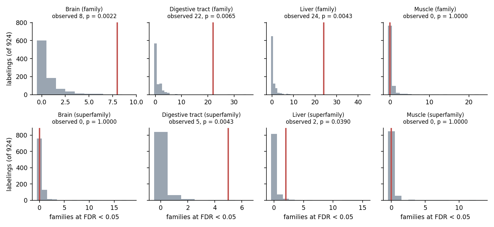
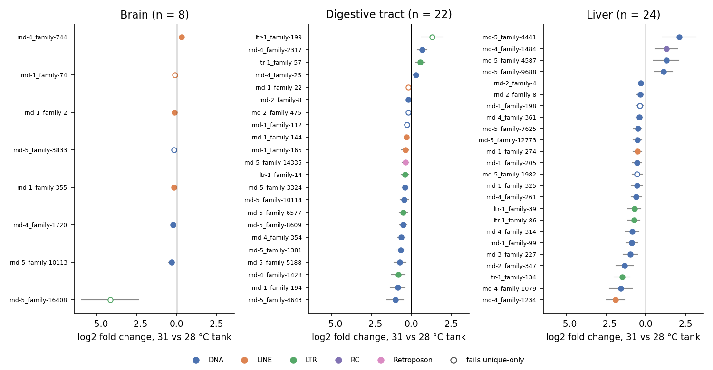
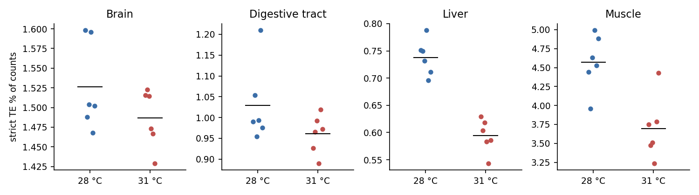
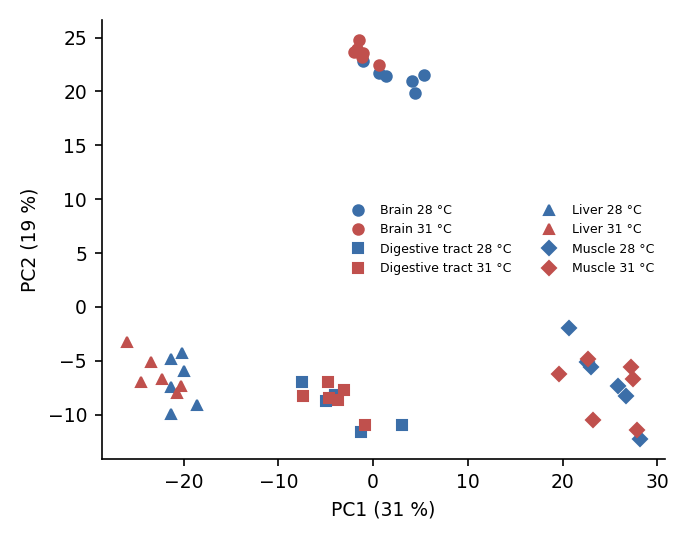
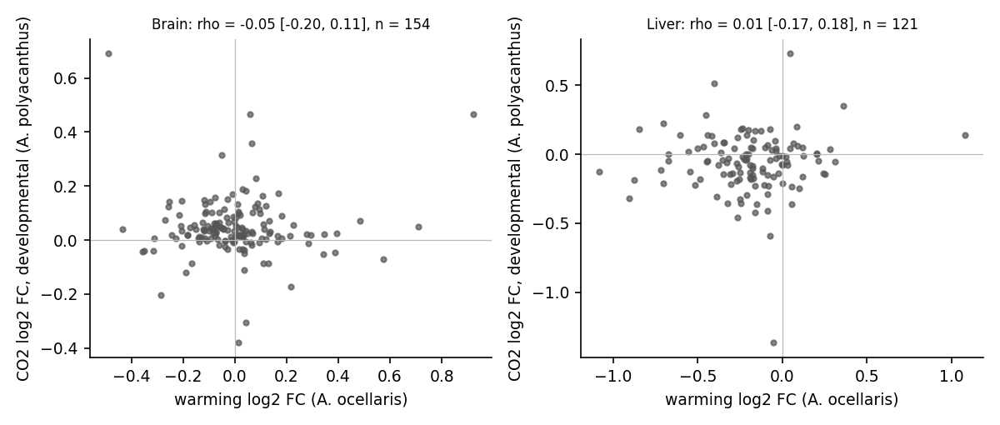

# Do transposable elements respond to ocean warming in clownfish?

**Author:** Kaisar Dauyey, Laboratory of Mathematical Biology, Hokkaido University, Japan  
**Request:** the human, 3 October 2026 07:45 UTC ("check for TE effect in the ocean warming study … PRJNA970523"), released by Michael (OHV-35).  
**Pre-registration:** `paper/results/te-warming-aocellaris-20261003/PREREGISTRATION.md`, base text plus Amendments 1 to 4 and their addenda, all passed by Phyllis (science) and Andy (numbers) before the stage they govern. Run record, scripts and compact tables are in the same folder, on branch `analysis/te-warming-aocellaris-20261003` of the private TE_Ocean_Acidification repository.  
**Reviewers:** Phyllis (science), Andy (numbers).  
**Date:** 4 October 2026.

## Summary

We re-analysed the 48 poly(A) RNA-seq libraries of Moore et al. (2024, *Sci Total Environ* 908:168221). In that experiment, post-larval *Amphiprion ocellaris* were reared in one tank at 28 °C or one tank at 31 °C, 6 larvae per tank. Brain, liver, muscle and digestive tract were sequenced from the same 12 larvae, and all larvae came from a single breeding pair. There was one tank per temperature, so no result here can separate temperature from any other difference between the two tanks. Every result is therefore a difference between the 28 °C tank and the 31 °C tank.

TE expression was quantified against the species' own RepeatModeler library (1,849 families) with the frozen OA pipeline. Each tissue was tested against the exact permutation null of all 924 ways to split its 12 larvae into two groups of six.

In three tissues, the 31 °C tank differed from the 28 °C tank in TE family expression by more than the null allows:

| Tissue | Classified TE families at FDR < 0.05 | Permutation p (threshold 0.0125) | Outcome |
|---|---|---|---|
| Brain | 8 | 0.0022 (the minimum reachable) | `TANK_TEMPERATURE_SHIFT_DETECTED` |
| Digestive tract | 22 | 0.0065 | `TANK_TEMPERATURE_SHIFT_DETECTED` |
| Liver | 24 | 0.0043 | `TANK_TEMPERATURE_SHIFT_DETECTED` |
| Muscle | 0 | 1.0 | `NO_DETECTABLE_TANK_SHIFT` (uninformative: muscle fails the gene positive control) |

The muscle row is not a negative result: muscle failed the gene-level positive control (101 genes against a null 95th percentile of 402), so its TE test has no demonstrated power. The shifts run mostly downward. In digestive tract 18 of 22 passing families were lower in the 31 °C tank (digestive-tract libraries from the 31 °C tank also map less well, a composition difference whose effect on TE counts was not examined), and in liver 20 of 24 (two-sided sign tests, p = 0.004 and 0.0015); in brain 7 of 8 were lower (p = 0.070), flagged as underpowered because fewer than 10 families passed, and nothing further is built on it. The changes are modest: the median |log2 fold change| of passing families is 0.22 in brain, 0.48 in digestive tract and 0.72 in liver.

A heat response is present. Heat-shock genes are induced in the 31 °C tank in all four tissues, *hspa8b* among them, so the tank difference includes heat stress. It cannot exclude other tank effects.

The global TE share of the transcriptome was lower in the 31 °C tank in liver (−0.14 percentage points) and muscle (−0.87 percentage points). The mobilisation extension (E1) found a tank shift in liver. Every passing family except one has no intact copy, and the exception (ltr-1_family-2) has intact copies that are not detected as transcribed, so the liver result still says nothing about potentially mobile elements. Fold changes between the 31 °C and 28 °C tanks do not track CO2 fold changes from the OA study in 121 to 154 matched families.

## Design and what it can show

The design has three limits that bound every sentence below.

- **One tank per temperature.** The 6 larvae in each group are replicates within one tank, not replicate tanks. The permutation p tests whether the two tanks differ by more than random splits of the same 12 larvae, which is a test of the tank difference.
- **One family.** All larvae share one breeding pair. The results do not generalise to other genotypes.
- **Libraries cannot be linked to fish.** The BioSample "isolate" field differs between tissues of the same larva and is a submission artefact (`design.tsv` column `biosample_isolate_ARTEFACT_not_fish_id`). Each tissue is therefore tested on its own, and the 48-library tissue model treats libraries as independent.

With 6 against 6, small fold changes will mostly go undetected. A null in muscle is not evidence of no TE change in muscle.

## Methods

**Reads and counting.** The 48 runs were downloaded from SRA and validated (`vdb-validate`, spot counts equal to the run table, sha256 recorded). They were trimmed with fastp 1.3.6 and aligned with STAR 2.7.11b (`--outFilterMultimapNmax 100 --winAnchorMultimapNmax 100`, index `--sjdbOverhang 149` for 150 bp reads) to GCF_022539595.1. Counting used TEcount 2.2.4 in multi mode, plus a unique-only pass, with `--stranded reverse` (column 3 share 0.020 on a 2 M-pair test library). No library was excluded under the registered rule: uniquely mapped rates were 57.2 to 96.0 % across the 48 (median 93.1 %; table `tables/star_qc_48.tsv`), all above the 50 % line, and TEcount completed for all. Digestive tract maps least well, and less well in the 31 °C tank (median 77.4 %) than in the 28 °C tank (85.9 %). That tank-linked difference in mappable fraction could affect the digestive-tract comparison through library composition. Its source, for example gut content, was not examined. Size factors correct for depth, not for composition of this kind.

**TE annotation.** The TE GTF came from the Mobilome comparative panel's RepeatModeler 2.0.9 / RepeatMasker 4.2.4 run on this assembly (`.out` sha256 9f51c6e7…), converted by the committed converter with all repeat classes kept. That run used `-a` and `-gff`, and simple repeats are present, so `-nolow` was not set; whether `-s` and `-no_is` were set cannot be confirmed from the outputs. The interspersed classes cover about 33.9 % of the genome.

**Model.** Each tissue was fitted with DESeq2 1.46.0, `~ temperature` (6 against 6), on the joint gene and TE table, with only rRNA rows dropped. The rRNA rows held 0.18 to 1.49 % of counts per library. Features were kept if they had ≥ 10 counts in ≥ 6 libraries, size factors were `poscounts`, and independent filtering was off. As in the OA analysis, gene and non-TE repeat rows stay in the table and shape the size factors and dispersion trend. Only classified TE families (DNA, LINE, SINE, LTR, RC, PLE, Retroposon) enter the primary Benjamini–Hochberg set. Unknown families form a separate labelled set that counts toward no outcome.

**Exact null.** For every one of the 924 labelings, the same function refits the model with the filter and size factors held fixed and dispersions re-estimated, and counts the classified families at FDR < 0.05. The permutation p is the share of labelings, the observed one included, with a count at least as high. A labeling and its mirror give the same count, so the smallest reachable p is 2/924 = 0.0022. With four tissues the threshold is 0.05 / 4 = 0.0125.

**Implementation choices and a disclosure.** Fold changes are not shrunk; confidence intervals are the maximum-likelihood estimate ± 1.96 SE.

The TE-versus-gene statistic (5.2.3) is the median |log2 fold change| of classified TE families divided by the median, over those families, of the gene median |log2 fold change| in the family's gene-baseMean decile.

The per-tissue counts of passing features and this ratio for the observed labeling were printed in the analyst's session when the timing fits ran, before the null existed. The fitting function and both choices were already fixed, and no stage was added or dropped after that point.

For the mobilisation extension (E1), a tissue is called `TANK_TEMPERATURE_SHIFT_INTACT` on a measure (unique or 1/NH-weighted counts; the tables call the latter `multi`) when both registered conditions hold on that measure. This per-measure rule was written down after the E1 null was computed. The outcome is identical under any combination of the two measures, because liver passes on both and no other tissue passes on either.

For E2, the OA CO2 fold change of a family is the mean, over the two parental phenotypes, of the full-set developmental (and, separately, intergenerational) log2 fold change in the OA response-pattern table (sha256 2699acba… of its uncompressed content).

**Compute.** 220.04 CPU-h on pSS against a 250 CPU-h ceiling. The ceiling was raised from 200 by the human after counting overran it (Amendment 4). The cause, oversubscription of multi-threaded STAR, is recorded in the run record.

## Results

### The tank difference includes a heat response (positive control)

In brain, digestive tract and liver, many more genes passed FDR < 0.05 in the 31 °C tank against the 28 °C tank than under all but 8 to 22 of the 924 labelings: 917, 1,017 and 1,436 genes, against null 95th percentiles of 127, 140 and 271 (Figure 1A). Muscle did not pass this control. Its 101 genes sit below its null 95th percentile of 402, which means some random splits of the muscle larvae produce more differential expression than the tank split does. This suggests the muscle libraries carry structure unrelated to the tank; its source was not examined. The registered rule (5.3.1) calls TE nulls uninformative only when no tissue passes the gene control, and three tissues pass. We extend its reading to muscle alone, which is not a registered consequence. We treat the muscle TE null as uninformative, not as evidence of no TE response.

Heat-shock genes rise in the 31 °C tank in every tissue (Figure 1B). *hspa8b* passes in all four (log2 fold change +1.1 to +2.6), and 8, 10, 11 and 4 heat-shock or DnaJ genes pass upward in brain, digestive tract, liver and muscle. One passes downward, in digestive tract.

Against the published differential-expression counts, only the top of the ranking agrees. Liver is the most responsive tissue in both. The paper found brain the least responsive (102 genes) and muscle second (447), whereas this pipeline finds muscle least responsive and brain close to digestive tract. The pipelines differ, so only ranking and direction were registered for comparison.

### TE families: a tank shift in brain, digestive tract and liver

The observed count of classified families at FDR < 0.05 lies beyond almost every labeling of the null in brain, digestive tract and liver (Figure 2, top row). In brain it ties only its own mirror (p = 0.0022). Digestive tract reaches p = 0.0065 (digestive-tract libraries from the 31 °C tank also map less well, a composition difference whose effect on TE counts was not examined), and liver p = 0.0043. The null medians are zero in every tissue, with long upper tails (95th percentiles 2 to 4 families), so a count of zero to four passing families is common under random splits, and the observed 8, 22 and 24 are not.

Most passing families are less expressed in the 31 °C tank than in the 28 °C tank (Figure 3). DNA transposons make up 63 % of the passing family–tissue pairs, against about 50 % of the tested families. That excess is descriptive and was not tested. In brain, five of the eight families move by less than 0.3 log2 units. The one large brain change, rnd-5_family-16408 (−4.2), fails the unique-only check and may be a multi-mapping artefact.

Across tissues, 45 of the 54 passing family–tissue pairs also pass when only uniquely mapped reads are counted: 5 of 8 in brain, 18 of 22 in digestive tract, 22 of 24 in liver. Muscle gains three families in unique mode that are not in multi mode.

Young families (median CpG-adjusted Kimura distance below 5 %) make up 3 of 8 families passing for the tank difference in brain (38 %, against 13 % of tested families), 3 of 22 in digestive tract (14 % against 13 %) and 4 of 24 in liver (17 % against 12 %). The brain excess rests on three families and was not tested. Near-identical young copies also collect fewer unique reads and are harder to resolve.

In the separate set of unclassified repeats, 2, 4, 29 and 0 families pass in brain, digestive tract, liver and muscle. These count toward no outcome. One of them, rnd-5_family-1756, has 72 % of its copies inside RefSeq exons and is likely a host-gene fragment. The others have 12 % or fewer of their copies in exons.

**Is TE expression shifting more than gene expression?** The registered descriptive statistic compares TE family fold changes with genes of matched expression level. Against the labeling null it gives no support for a TE-specific shift beyond the transcriptome-wide tank difference (upper-tail p 0.17 to 0.60). With 6 against 6, a modest TE-specific component could be missed.

### Superfamilies (E3)

Summed to superfamily, the tank shift remains in digestive tract (digestive-tract libraries from the 31 °C tank also map less well, a composition difference whose effect on TE counts was not examined): 5 superfamilies at FDR < 0.05, p = 0.0043, all lower in the 31 °C tank, with |log2 fold change| 0.16 to 0.38. They are Helitron, TcMar-Tigger, Kolobok-T2, the LINE superfamily I, and Retroposon. Liver has 2 superfamilies (hAT-hAT5, TcMar-Mariner), but p = 0.039 does not reach the threshold, and brain and muscle have none. Summing family counts trades resolution for power. Here the signal weakens rather than strengthens. One possible reason is that families within a superfamily move by different amounts or in opposite directions, but this was not examined.

### Global TE share of the transcriptome

The share of counts assigned to classified TE families is lower in the 31 °C tank than the 28 °C tank in liver, by 0.14 percentage points (95 % CI 0.10 to 0.18; Hedges' g −4.2; Welch p < 0.0001; Mann–Whitney p = 0.0022). It is also lower in muscle, by 0.87 points (CI 0.37 to 1.38; g −2.1; p = 0.003). Brain and digestive tract show small decreases whose intervals include zero (Figure 4). Absolute index values are not compared with other cohorts.

The muscle result shows a share-level drop with no family passing individually. The muscle positive control also failed, so this tissue's tank comparison carries structure we cannot attribute.

### Tissue structure (descriptive)

TE family expression separates the four tissues cleanly (Figure 5; PC1 31 %, PC2 19 % of variance among the 500 most variable classified families). Within each tissue, the two tanks overlap on these axes. This confirms that TE expression is measurable and tissue-specific in these libraries. The 48-library model cannot fit a fish term, so only effect sizes from it are used.

### Mobilisation framework (E1)

The mobilisation study's pipeline was applied unchanged except for inputs. Of 1,010,533 annotated copies, 328 are intact and young (T1), 6 are coding-capable unclassified (T1u), 145 are young full-length SINEs (SINE-T) and 6,181 are partial (T2). The shuffle comparison uses the 246 T1 loci in intergenic or intronic context, the set for which length- and context-matched shuffles are drawn under the mobilisation rules. These loci are detected well above shuffled non-TE intervals in every tissue: 41 %, 26 %, 22 % and 20 % of loci in brain, digestive tract, liver and muscle, against shuffle means of 17 %, 8 %, 5 % and 7 % (p = 0.001 against 999 shuffles in each).

Fourteen T1 families have at least one intact copy that is transcribed in its own right (self-driven) in some tissue; 29 are detected only as passengers of host transcripts. As in the source study, self-driven means coverage above the flanks in unstranded short reads, not a demonstrated promoter. Nothing here shows transposition.

The registered warming test on these families' summed counts gives, for liver, `TANK_TEMPERATURE_SHIFT_INTACT` on both measures: 3 families on unique counts and 7 on 1/NH-weighted counts, both p = 0.0065 (Figure 6). On closer inspection, every passing family except one has no intact copy. Their sums are carried by partial (T2) and other non-intact loci. We label these `NO_INTACT_COPIES`, a descriptive label added at reporting and outside the four registered family outcomes. The exception is ltr-1_family-2, whose intact copies are `INTACT_NOT_DETECTED`. The liver result is therefore a shift in fragment-dominated TE families. It does not show that warming changes the expression of potentially mobile elements in this tank comparison. Brain, digestive tract and muscle show no intact-tier shift on either measure.

### Warming against CO2 (E2, descriptive)

Of the 1,849 *A. ocellaris* families, 167 have a one-to-one reciprocal best match in the OA *A. polyacanthus* library under the 80-80-80 rule. Of these, 154 were tested in brain and 121 in liver (about 9 % of the families tested here). Warming fold changes in the 31 °C tank do not track the OA CO2 fold changes for the matched families. Spearman ρ is −0.05 (95 % CI −0.20 to 0.11) for brain and developmental CO2, and 0.10 (−0.06 to 0.25) for brain and intergenerational CO2. In liver it is 0.005 (−0.17 to 0.18) and 0.001 (−0.18 to 0.18). Sign concordance is 45 to 60 % (Figure 7).

This comparison spans two species, two stressors, two ages and two rearing designs, and covers under a tenth of the families. It cannot say whether the two stressors act on TEs differently.

## Interpretation

Between the two tanks, the 31 °C tank shows lower expression of a few dozen TE families in liver and digestive tract and a handful in brain, beyond what random splits of the same larvae produce (digestive-tract libraries from the 31 °C tank also map less well, a composition difference whose effect on TE counts was not examined). Liver also shows a lower overall TE share of the transcriptome. A heat-shock response is present in every tissue, so the difference between the two tanks includes thermal stress.

Three things limit what this means.

1. The design has one tank per temperature, so the shift could come from any tank difference: temperature, but also feeding, density, microbiota or handling.
2. The TE shift is not detectably larger than the general transcriptome shift between the tanks. The data therefore do not support a TE-specific response such as a release of silencing, though a modest one could be missed at this sample size.
3. Where the mobilisation framework finds a liver shift, every passing family except one has no intact copy, and the exception (ltr-1_family-2) has intact copies that are not detected as transcribed. So the liver result still says nothing about potentially mobile elements.

The data therefore do not support the idea that warming activates potentially mobile TEs in clownfish larvae. They do show that TE family expression moves with the broader transcriptional difference between the two tanks, mostly downward.

Muscle needs separate caution. It failed the positive control: its gene null is wider than its tank effect. Its TE null is therefore uninformative, despite a lower TE share in the 31 °C tank.

A replicated design, with several tanks per temperature and fish linked across tissues, would be needed to attribute any of this to temperature.

## Reproduction

Scripts are in `paper/results/te-warming-aocellaris-20261003/scripts/`. Per-library processing: `process_one.sh`, driven by `run_all.sh`. The 5.1 fits and E3: `deseq_fit.R` through `run_perms.sh`. Summaries: `summarize_nulls.py` and `summarize_secondary.py`. E1: `e1_stage12.sh`, `e1_stage3_calls.py`, `e1_stage4_warming.R` through `run_e1_stage4.sh`, and `e1_summarize.py`. E2: `e2_match.sh` and `e2_rbh.py`. Figures: `make_figures.py`.

The compact tables are in `tables/`. File hashes, versions, per-process CPU time and every deviation are in `RUN_RECORD.md`. The BAMs (144 GB) remain on pSS until Michael decides.
