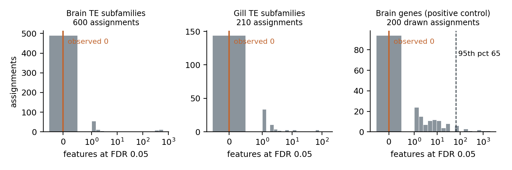
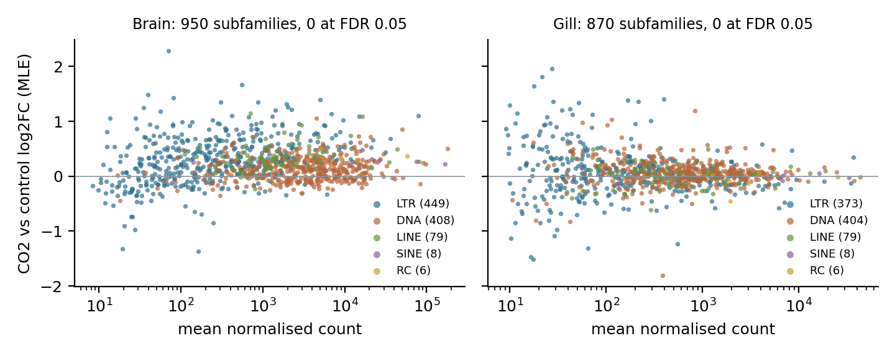
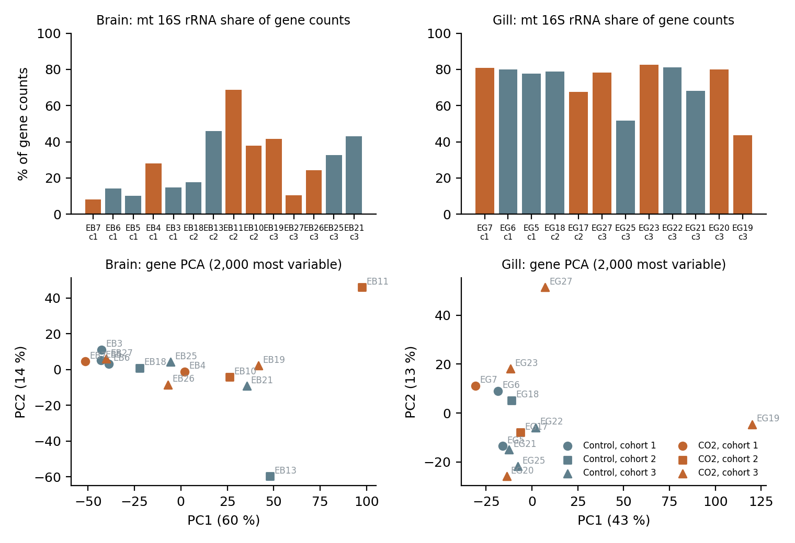
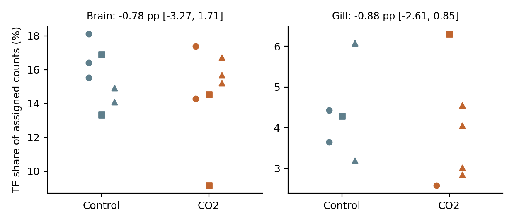
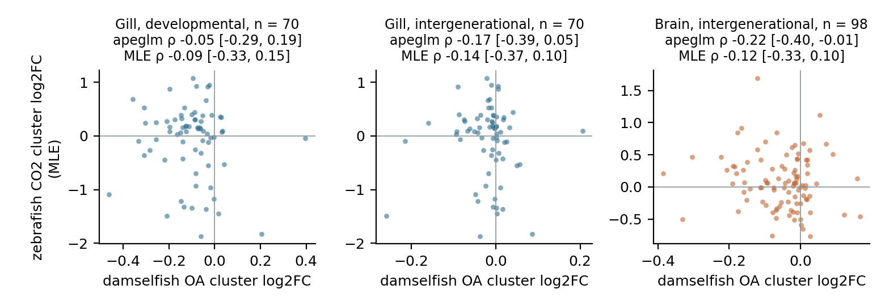

# Acute CO2 and TE expression in adult zebrafish brain and gill: results

**Author:** Kaisar Dauyey, Laboratory of Mathematical Biology, Hokkaido University, Japan  
**Request:** the human's go for the acute TE activity check, 5 October 2026, passed on by the orchestrator (message dc3322). The cap was raised to 75 CPU-h on 6 October (OHV-57).  
**Status:** complete under the frozen design (PREREGISTRATION `8b4486a1d28b`, registered at 77270d9). Implementation choices were fixed at af6c2bd before any downstream fit. For review by Phyllis (science) and Andy (numbers). Code and tables are on TE_OA branch `analysis/zf-acute-run-20261006`.  
**Date:** 6 October 2026.

## Summary

The check asked whether five days at about 1,000 µatm CO2 shift transposable element (TE) expression in the brain or gill of adult zebrafish (PRJNA1102381, 26 libraries). Gill gives no detectable TE response; brain carries no TE reading, because its gene positive control failed.

- **Gill: NO_DETECTABLE_TE_SHIFT.** 0 of 870 TE subfamilies are at FDR 0.05 (permutation p 1.0 over all 210 within-cohort assignments; Holm p 1.0). An observed count of 0 gives p = 1 by construction. With 6 against 6 libraries, and mitochondrial 16S rRNA taking 44 to 83 % of gene counts, the test had power only for broad or strong shifts.
- **Brain: UNINFORMATIVE.** 0 of 950 TE subfamilies are at FDR 0.05 (p 1.0 over 600 assignments). The registered brain gene positive control fails, so the design does not let this null be read as evidence about TEs. The control gives 0 genes at FDR 0.05, against 65 at the 95th percentile of its own null. The published brain gene changes are not reproduced here.
- **Sensitivities.** All six registered sensitivities also give 0 subfamilies: unique-read counts, the label-exclusion sets and the model without a cohort term.
- **TE share of expression.** No clear shift in either tissue: brain −0.78 percentage points [−3.27, 1.71], gill −0.88 [−2.61, 0.85].
- **Comparison with damselfish OA (exploratory).**
  - The registered apeglm ρ is −0.05 (gill developmental), −0.17 (gill intergenerational) and −0.22 (brain intergenerational). The brain interval [−0.40, −0.01] excludes zero.
  - apeglm compressed every fold change to about 10⁻⁵, so its ranks rest on numerical residues.
  - The MLE ρ, added after the fits, is −0.09 to −0.14, with every interval spanning zero.
  - Neither ρ is read.

**Composition.** Mitochondrial 16S rRNA accounts for 8 to 69 % of gene counts in brain libraries and 44 to 83 % in gill. In brain, this share is the main axis of gene-level variation (PC1, 60 % of variance, Spearman 0.98 with the share). It is a plausible reason for the failed control. The design cannot confirm it.

**Compute.** The check used about 54.5 of its 75 CPU-h. Nothing here bears on transposition.

## What was run

**Data.** PRJNA1102381 (Sourisse et al. 2025) covers adult AB zebrafish, 4 months old, held at about 500 or about 1,000 µatm CO2 for 5 days in three cohorts:
- 14 brain libraries (7 control, 7 CO2) and 12 gill libraries (6 and 6);
- polyA, paired-end 2 × 151 bases, 834.9 M pairs in total.

Treatment labels come from the paper's supplementary tables, by the mapping fixed before download.

**Pipeline.** The pipeline is the zebrafish archive's, as in Tier B of the zebrafish-background study:
1. `prefetch` with `vdb-validate`;
2. fastp 1.3.6;
3. STAR 2.7.11b against the Ensembl 112 index, keeping up to 100 multi-mapping hits;
4. TEcount 2.2.4 in multi mode, unstranded.

All 26 libraries ran on S: the first three on 5 October (finished by 20:22Z), then, after a pause for the cap decision, the remaining 23 from 03:06Z to 08:37Z on 6 October. Each STAR process loads the genome itself, a deviation the orchestrator accepted; loading mode does not change alignments. Two further passes ran over the same BAMs:
- featureCounts 2.0.8 on the Tier A R1 cluster annotation (1/NH fractions);
- TEcount in unique mode for the sensitivity.

**QC.** No library was excluded. The registered exclusion rules are unique mapping below 30 % or fewer than 5 M assigned fragments. Observed ranges were 68.8 to 91.6 % unique and 24.0 to 30.9 M assigned. One gill library, EG7 (SRR28763310), has 29 % multi-mapping reads, against 4 to 13 % in the others.

**Statistics.** DESeq2 1.46.0 was fitted within each tissue with `~ cohort + treatment`.
- **Rows and size factors.** These are fixed once per tissue and used unchanged in every observed and permuted fit. The filter keeps rows with ≥ 10 counts in at least as many libraries as the smaller group.
- **TE set.** The tested set is the 1,011 subfamilies of class DNA (including one DNA? row), LINE, LTR, SINE and RC. Simple repeats, satellites, RNA genes and Unknown are not tested.
- **Statistic and null.** The statistic is the number of subfamilies at Benjamini–Hochberg FDR 0.05, with independent filtering off. Its null enumerates every assignment of labels within cohorts that keeps the group sizes.
- **Brain gene control.** It compares the observed brain gene count with the 95th percentile of 200 drawn assignments.

## Primary result

| Tissue | TE subfamilies tested | At FDR 0.05 | Permutation p | Holm p | Reading |
|---|---|---|---|---|---|
| Brain | 950 | 0 | 1.0 (600 assignments) | 1.0 | UNINFORMATIVE |
| Gill | 870 | 0 | 1.0 (210 assignments) | 1.0 | NO_DETECTABLE_TE_SHIFT |

**Gill.** No subfamily reaches FDR 0.05 under the observed labels. An observed count of 0 gives p = 1 by construction, so the permutation p adds nothing beyond "none called". With 6 against 6 libraries, and mitochondrial 16S rRNA taking 44 to 83 % of gene counts, the test had power only for broad or strong shifts.

**Long null tails.** Under the observed labels, no subfamily reaches FDR 0.05 in either tissue. Most permuted assignments also give 0, but a few give hundreds (brain maximum 625, gill 142). Such a tail is expected when TE subfamilies share a common source of variation: an assignment that happens to line up with that source calls many of them at once. No single library is over-represented among the high assignments.

**Gene control.** It was registered to check that the processing and the naming-inferred brain labels can recover the published brain gene response. It fails clearly:
- 0 of 19,337 brain genes are at FDR 0.05;
- only 2.4 % of brain genes have an unadjusted p below 0.05, fewer than the 5 % expected under no effect;
- the 95th percentile of the drawn null is 65 genes.

Gill, which has no control by design, gives 3 genes at FDR 0.05.

**Effect sizes.** The MLE fold changes of TE subfamilies are small and centred on zero (median absolute 0.24 in brain, 0.15 in gill). apeglm shrank every subfamily to an absolute value of at most about 3 × 10⁻⁵: the fitted prior's scale was near zero.

**Sensitivities.** Every sensitivity agrees with the primary fit and gives 0 subfamilies at FDR 0.05:
- unique-read TEcount counts;
- brain without EB19 and EB21 (the supplement's brain-sample discrepancy);
- gill without EG19 and EG22 (absent from the supplement's gill figure);
- both tissues without the cohort term.

## Library composition (descriptive, added after the fits)

**Brain.** One Ensembl feature, the mitochondrial 16S rRNA gene (ENSDARG00000080337), takes 8 to 69 % of brain gene counts. The first principal component of brain gene expression explains 60 % of the variance and follows this share almost exactly (Spearman 0.98). The extreme library, EB11 (CO2, cohort 2), has a size factor of 0.20.

The mean share is 26 % in control and 31 % in CO2, so the axis is not aligned with treatment. Brain cohort 1 has the lowest shares (8 to 28 %, against 10 to 69 % in cohorts 2 and 3), so the cohort term absorbs part of this axis. It does add a large amount of variance that the model must absorb. With seven fish per group, that alone could hide a moderate gene response. We cannot tell from these data whether this, a difference in the published pipeline, or a labelling problem is responsible. The naming-inferred brain labels were the reason for the control.

**Gill.** The share is uniformly high (44 to 83 %). EG19 has the lowest share and stands apart on PC1. It is one of the two gill libraries the paper's supplementary gill figure does not show, and the supplement gives no reason. The registered sensitivity without EG19 and EG22 does not change the gill result.

The QC rules fixed before the data do not cover rRNA content, so no library was excluded. The effective gene-level depth is therefore lower and more uneven than the 24 to 31 M assigned fragments suggest.

## Secondary and descriptive results

**TE share.** TE subfamilies take about 15 % of assigned counts in brain and about 4 % in gill. The cohort-adjusted CO2 effect is −0.78 percentage points [−3.27, 1.71] in brain and −0.88 [−2.61, 0.85] in gill. Both intervals span zero and are wide relative to the gill mean.

**Cluster comparison with damselfish OA** (exploratory, no p and no reading). The zebrafish side uses fold changes on the 573 shared-library clusters, of which 349 are covered in brain and 246 in gill; none is at FDR 0.05. Damselfish values are the full-cohort OA fold changes of the same tissue.

| Comparison | Matched clusters | ρ, registered (apeglm) | ρ, MLE | Same sign (MLE) |
|---|---|---|---|---|
| Gill, developmental | 70 | −0.05 [−0.29, 0.19] | −0.09 [−0.33, 0.15] | 0.41 |
| Gill, intergenerational | 70 | −0.17 [−0.39, 0.05] | −0.14 [−0.37, 0.10] | 0.40 |
| Brain, intergenerational | 98 | −0.22 [−0.40, −0.01] | −0.12 [−0.33, 0.10] | 0.45 |

**The registered ρ.** It uses apeglm fold changes. Here apeglm compressed all values to at most about 1 × 10⁻⁵ for clusters, so their ranks rest on numerical residues. The MLE ρ was added beside it after the fits, with the same bootstrap seed. The registered brain interval just excludes zero; the MLE interval does not.

The fair summary is weak, slightly negative agreement throughout, with fewer than half the clusters sharing a sign. The two species differ by 200 to 250 million years of divergence, in salinity and in exposure length, so even a clear correlation would have been suggestive at most.

**Genic and intergenic reads.** This split was planned for called subfamilies only. No subfamily was called, so it was not run.

## Limits

- **Brain carries no TE reading.** A failed positive control means the brain null cannot be separated from a processing, labelling or composition problem.
- **Power.** With 7 against 7 and 6 against 6, a doubling of CO2 for five days and high rRNA content, the gill test had power only for broad or strong shifts. A null reading does not show that zebrafish TEs are unresponsive to CO2.
- **Design scope.** One strain, one laboratory and 4-month-old fish, with sexes not recorded. The exposure is fresh water, chemically unlike the damselfish seawater treatments.
- **Counting.** TEcount multi mode assigns intronic and UTR TE reads with their host genes and distributes multi-mapping reads by an EM model. Subfamily totals, not loci, were tested.
- **Transposition.** Nothing in this design can show transposition.

## Deviations, compute and records

**Deviations and additions.**
- **Genome loading:** each STAR process loads the genome itself (accepted).
- **Peak disk:** about 252 GB, against the registered estimate of 180 GB. The 100 GB download cap was met.
- **Cap:** raised from 35 to 75 CPU-h by the human before the remaining 23 libraries ran.
- **Separate R environment:** the same DESeq2 1.46.0, plus apeglm 1.28.0, which the frozen environment lacks.
- **Added after the fits:** the MLE comparison and the composition diagnostic. Neither changes a registered quantity or reading.
- **Report name:** follows the orchestrator's instruction.

**Compute.**

| Item | CPU-h |
|---|---|
| Download | 0.31 |
| Pipeline (26 libraries) | 40.47 |
| featureCounts cluster pass | 0.63 |
| TEcount unique pass (sensitivity) | 11.11 |
| DESeq2 fits (1,023 in all)¹ | 2.00 |
| **Total** | **about 54.5 of 75** |

¹ The 1,023 fits break down as follows:
- 4 observed fits: TE and gene, per tissue;
- 810 TE permutation fits: 600 brain and 210 gill. These include assignment 0, a refit of the observed labels;
- 201 brain gene-control fits: the observed labels plus 200 draws;
- 6 sensitivity fits;
- 2 cluster fits.

The registered design projected 32.9 CPU-h. It underestimated the per-library pipeline rate and did not count the unique TEcount pass.

**Records.** On TE_OA branch `analysis/zf-acute-run-20261006`:
- `RUN_RECORD.md`;
- per-library QC (`tables/qc.tsv`);
- every fit output, permutation and draw (`tables/primary`, `tables/assign`);
- descriptive and comparison tables;
- the scripts `acute_*.py` and `acute_*.R`.

Temporary FASTQ slot folders on S are kept, as the human asked.
